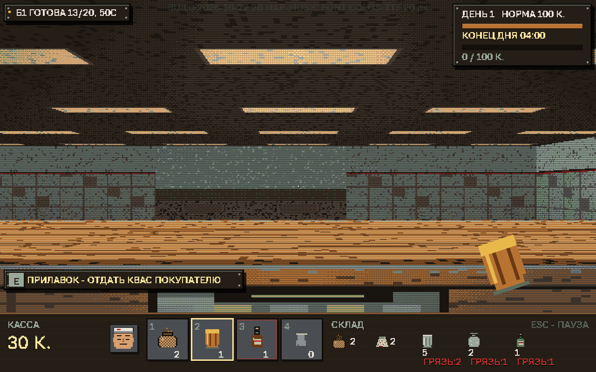
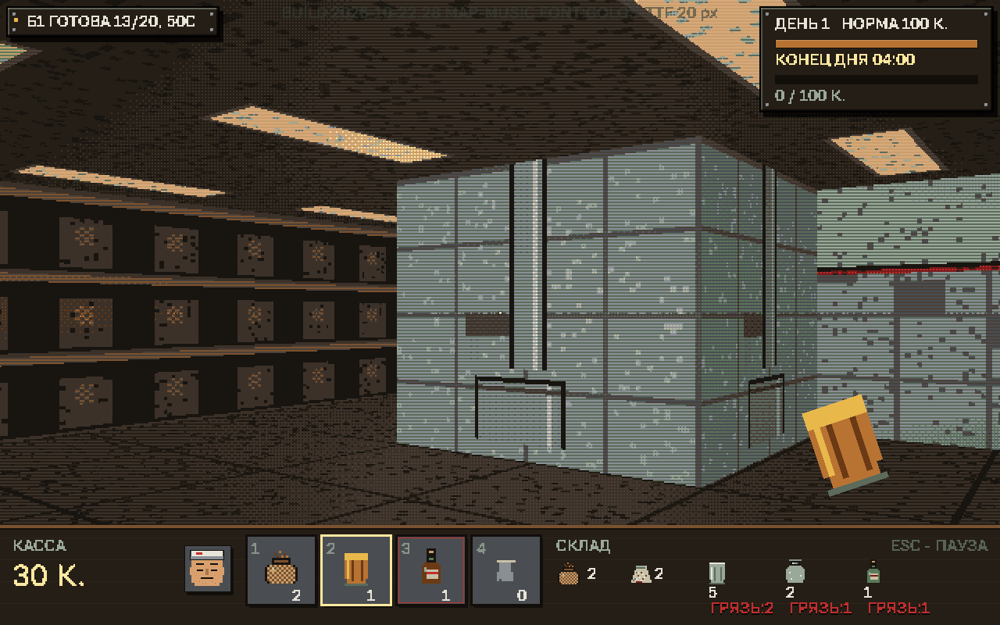
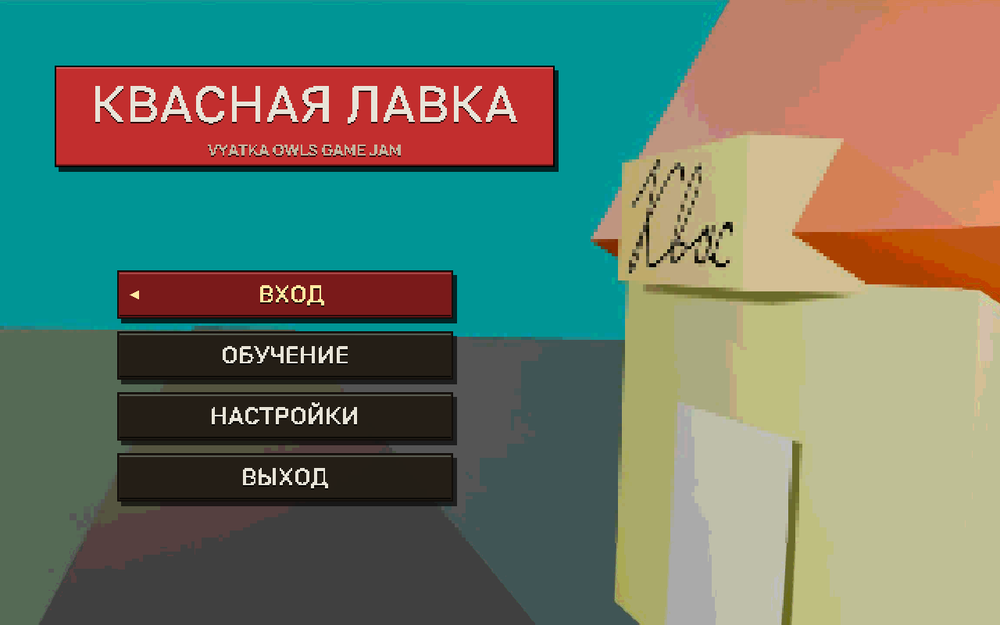
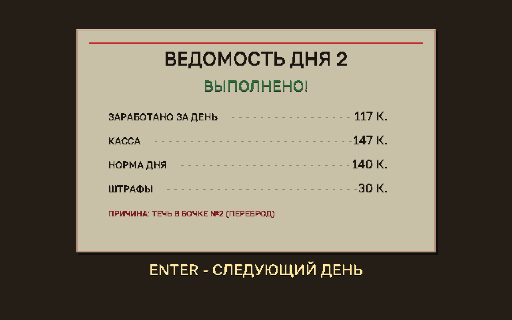
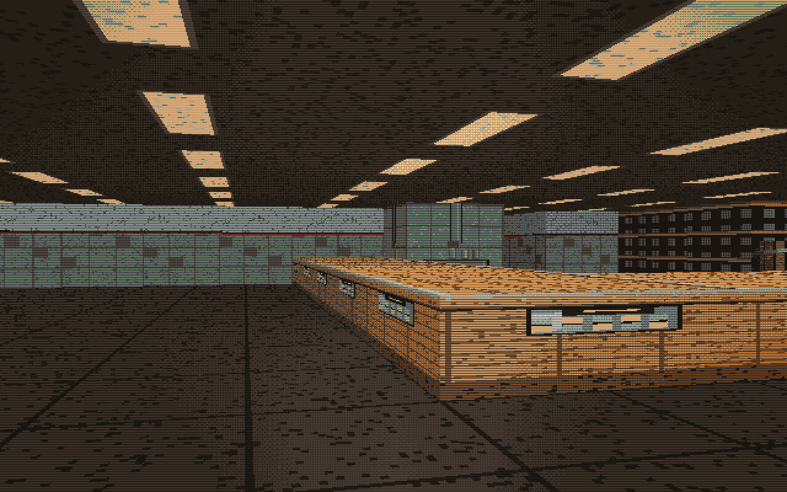
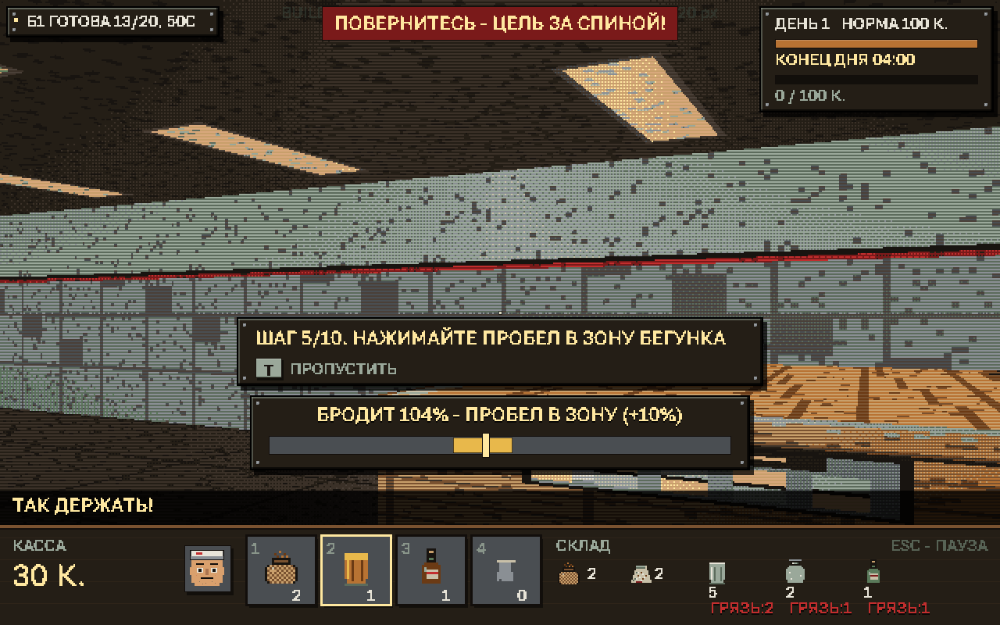

# КВАСНАЯ ЛАВКА

Soviet kvass shop — Doom-style рейкастер на Rust + Bevy. Vyatka Owls Game Jam.

Пиксель-арт 640×400, собственная CPU-рейкастерная отрисовка (DDA по Лодеву),
палитра на 24 цвета, Doom-colormap, дизеринг Байера. Кириллический интерфейс.

## Скриншоты

| Торговый зал | Склад |
|---|---|
|  |  |

| Главное меню | Итоги дня |
|---|---|
|  |  |

Прилавок — ряд честных полублоков: у каждого тайла свой фасад и столешница,
без «невидимых кубов» и исчезающих касс:



Обучение встроено в первый день: шаги, цели и подсказки.



---

## Сборка бинарника

Код менять не нужно — игра собирается из коробки.

### Требования

* **Rust 1.78+** (нужен для `edition = "2021"` и актуального Bevy)
* На Linux — системные зависимости Bevy (ALSA, udev, X11):

**Fedora:**

```bash
sudo dnf install gcc pkgconf-pkg-config alsa-lib-devel systemd-devel \
    libxkbcommon-devel libX11-devel libXcursor-devel libXi-devel libXrandr-devel
```

**Arch:**

```bash
sudo pacman -S --needed gcc pkgconf alsa-lib systemd-libs libxkbcommon \
    libx11 libxcursor libxi libxrandr
```

**NixOS:**

```bash
nix-shell -p rustup gcc pkg-config alsa-lib systemd libxkbcommon \
    libX11 libxcursor libxi libXrandr
rustup default stable
```

> На NixOS бинарник может не стартовать из-за FHS — тогда запускайте через
> обёртку: `nix-shell -p steam-run --run ./target/release/kvass-shop`.

**Debian / Ubuntu:**

```bash
sudo apt update
sudo apt install -y build-essential pkg-config libx11-dev libxcursor-dev \
    libxrandr-dev libxi-dev libxkbcommon-dev libwayland-dev \
    libasound2-dev libudev-dev
```

Без пакетов сборка упадёт на стадии линковки `bevy` (нехватка `libX11`,
`libasound` и т.п.), а не в коде игры.

### Linux — релизная сборка

```bash
cd kvass
cargo build --release
```

Бинарник появится в `target/release/kvass-shop`. Запуск:

```bash
./target/release/kvass-shop
```

> Игра стартует **полноэкранным** окном (BorderlessFullscreen на первичном
> мониторе). Чтобы выйти — `ESC`, оттуда `ESC` ещё раз в меню.

### Windows

Готовый exe — в [Releases](https://github.com/dodry-question/kvass/releases/latest).
Он **самодостаточен**: музыка, SFX, шрифты, фон и иконка уже внутри, папка
`assets` для запуска не нужна.

Сборка из исходников (папка `assets` нужна только на этапе компиляции — всё
вшивается в exe):

```powershell
cargo build --release
.\target\release\kvass-shop.exe
```

### Запуск в Bottles (Linux, Wine)

1. Создайте бутылку (тип **Gaming**) и поставьте в ней зависимости
   **DXVK** и **VKD3D** (в настройках бутылки). Это обязательно: Bevy
   рисует через Direct3D 12, который в Wine идёт через vkd3d → Vulkan.
2. Положите `kvass-shop.exe` в бутылку (например, в `drive_c/kvass-shop/`).
   Папка `assets` не нужна — все ресурсы вшиты в exe.
3. В Bottles: «Запустить EXE» / «Добавить ярлык» → выберите `kvass-shop.exe`.
4. Если чёрный экран или окно не появляется — запустите exe с аргументом
   `--windowed` (в Bottles: поле «Аргументы» у ярлыка): игра откроется
   обычным окном вместо полноэкранного borderless. С ним же запускайте
   в первый раз.
5. Нет звука — проверьте, что в бутылке выбран PulseAudio/PipeWire.

> exe собирается со статичным CRT (`.cargo/config.toml`), поэтому
> Visual C++ Redistributable в Wine не требуется.

### Пакетирование для раздачи (Linux)

Бинарник самодостаточен: музыка, SFX, шрифты и фон вшиты, папка `assets`
для запуска не нужна. Достаточно одного файла:

```bash
cargo build --release
mkdir -p dist
cp target/release/kvass-shop dist/
tar -C dist -czf kvass-shop-linux.tar.gz kvass-shop
```

Раздаёте `kvass-shop-linux.tar.gz` — распаковал, запустил `./kvass-shop`.
Никаких дополнительных библиотек не требуется.

---

## Управление

| Клавиша | Действие |
|---|---|
| `W A S D` | ходьба |
| мышь | поворот (захват курсора — ЛКМ) |
| `E` / ЛКМ | действие: взять/положить, розлив (удерживать), отдать покупателю |
| `SPACE` | **ускорить брожение** — только пока бочка бродит |
| `1–4` | слоты рук |
| `ENTER` / `Space` | подтверждение (меню, склад, конец дня) |
| `ENTER` / `Space` / клик по «ОК» | закрыть благодарность после 3-го дня и выйти в меню |
| `1 2` на складе | закупка сухарей / сахара (партия 3 шт) |
| `1 2 3` у бандита | отдать 15 К. / использовать предмет / соврать |
| `T` | пропустить обучение |
| `` ` `` / `ё` / `~` | **отладочная консоль** (в меню и в игре) |
| `ESC` | **пауза**: продолжить / в главное меню / выход из игры |

### Отладочная консоль

Открывается физической клавишей `` ` `` (Backquote; на русской раскладке —
`ё`, рядом с `~`) в меню и в игре. Пока консоль открыта, игровое время, NPC,
бочки, музыка и звуки стоят. Закрыть — `` ` `` или `ESC`.

| Команда | Действие |
|---|---|
| `day 1`, `day 2`, `day 3` | загрузить соответствующий день |
| `stop` | остановить игровое время (игрок при этом может ходить) |
| `play` | продолжить время; без активного `stop` ничего не делает |
| `band` | следующий переход склад → касса гарантированно вызывает бандита (работает и при включённом `unband`) |
| `unband` | выключить случайных бандитов из-за угла полностью; повторный ввод — включить обратно |
| `help` | список команд |

Лимит появлений бандитов за день: **1-й день — 1**, **2-й — 3**,
**3-й — 4**. Считается только сцена в коридоре: бандитов в очереди больше
нет. `unband` не сбрасывает уже израсходованный лимит; новый день
начинает счёт заново. `band` обходит и `unband`, и лимит — ровно на одну
сцену.

---

## Как играть

0. **Предыстория.** Перед первым днём показывается окно с историей деда и
   рецептом кваса. `ENTER` / `ПРОБЕЛ` / `E` — начать; после этого идёт
   чёрная заставка «ДЕНЬ 1». Ту же предысторию видно после обучения, если
   оно было входом в игру.
1. **Склад.** Сырьё покупают в окне снабжения: `1` — сухари, `2` — сахар
   с изюмом. Одна закупка — **3 шт.** (сухари 6 К., сахар 3 К.), товар
   привозят на склад через 3–5 секунд. Посуда не покупается: она
   многоразовая, грязную моют в мойке.
2. **Варка.** У бочки нажимайте `E` столько раз, сколько требует шаг:
   сухари → вода (наберите ведро у колонки) → сахар. Бочка начинает бродить
   **18–28 секунд** до 100%. Одна варка даёт **10 порций**.
3. **Ускорение брожения (мини-игра).** Подойдите к бродящей бочке и нажмите
   `SPACE` — снизу появится полоска с подсвеченной зоной и бегунком.
   Попадите `ПРОБЕЛОМ` в зону — **+10%** к брожению. Не подходили — бочка
   бродит обычной скоростью (авто-режим), ничего делать не надо.

   > **Осторожно с перебродом.** Шкала идёт дальше 100%:
   > **125% — переброд** (разливать можно, но вдвое дешевле),
   > **150% — испорчена** (нужно мыть, штраф за грязь).
   > Ускоряйте до готовности, а после — оставьте бочку в покое.

   **Первый переброд (день 1).** Когда бочка впервые доходит до 125%,
   смена и покупатели замирают, а на экране появляется тревога. Бочка
   портится медленнее обычного: у игрока есть около минуты. Стрелка ведёт
   к колонке, если ведра нет, а затем к бочке. Нажмите `E` с ведром у
   бочки — квас спасён, время снова идёт. Если не успели, показывается
   «квас испортился», и время остаётся остановленным, пока бочку не вымоют
   удержанием `E`. Дальше переброды идут с обычной скоростью.
4. **Розлив.** Возьмите пустую посуду с полки (`E`), подставьте под кран
   бочки и **держите `E`**.
5. **Выдача.** Подойдите к прилавку лицом к покупателю и нажмите `E`.
6. **Гигиена.** Испорченную бочку мойте: держите `E` у неё. Грязь копится
   и штрафуется милицией (проверка приходит со 2-го дня).
7. **Бандит в коридоре.** Когда возвращаетесь со склада к кассе, есть
   небольшой шанс (около 30%) встретить бандита: он выбегает из-за угла,
   мир замирает. Можно отдать
   `15 К.`, использовать предмет из рук/со склада или соврать. Ложь — 50/50:
   поверит и уйдёт либо ударит, и тогда правая половина экрана на минуту
   мутнеет и расплывается в тёплой дымке («подбитый глаз»; проверить
   эффект можно командой `hit` в отладочной консоли). За день бандиты появляются не чаще
   лимита (см. отладочную консоль); `band` в консоли гарантирует встречу.
   В очереди бандитов больше нет — только сцена из-за угла.
8. **Час пик (день 3).** Ровно в середине третьей смены (13:00 по игровым
   часам) гудит заводской гудок: с завода идут **4–5 работяг** и требуют
   только **трёхлитровые банки** (2 порции кваса, чек 10 К.). Очередь
   вмещает троих — остальные ждут за дверью и заходят по одному, как только
   место освобождается. Пока толпа не разошлась, обычные покупатели не
   приходят, а бандиты не суются. Терпение у кассы короткое: держите
   готовую бочку (10 порций), чистые банки и не зевайте.

Цель — выполнить норму дня. В игре ровно **три дня** — у каждого своя
проверка: **день 1** — обучение и первый переброд, **день 2** — бандиты,
**день 3** — заводской гудок и толпа работяг. После итогов
третьего дня показывается благодарность за игру, а кнопка **ОК**
возвращает в главное меню. Четвёртого дня нет.

---

## Самотест (отрисовка без окна)

Полезно при правках рендера: рисует кадры всех экранов в BMP и выходит,
окно не открывается.

```bash
cargo run --release -- --selftest
```

Файлы появятся в `selftest_out/`:

| Кадр | Что проверяет |
|---|---|
| `1_menu` | главное меню, титул, киоск |
| `2_supply` | окно снабжения |
| `4_playing` | игровой день: мир + HUD + диалоги |
| `5_dayend`, `6_final` | итоги дня, благодарность за игру |
| `7_font` | все глифы, включая кириллицу |
| `8_tutorial` | панель обучения + маркер |
| `9_npcs` | образы NPC |
| `10_spriteonly` | мир **без HUD** — видимость людей |
| `11_close` | камера вплотную к прилавку |
| `12_wallclose` | камера вплотную к стене |
| `13_counter_row` | ряд прилавков под острым углом |
| `13b`–`13e` | фазы бочки: бродит / готово / переброд / испорчена |
| `13f`–`13h` | первый переброд: тревога, полив, провал и мойка |
| `23c_spawn_view` | вид со стартовой точки |
| `23d_storage` | склад: сухари, сахар, вода |
| `23e_story` | предыстория перед первым днём |
| `23f_debug` | отладочная консоль |
| `23g_ambush_choice` | сцена бандита: три варианта |
| `23h_ambush_black_eye` | ложь не сработала: подбитый глаз |

BMP → PNG:

```bash
python -c "from PIL import Image; import glob; [Image.open(f).save(f.replace('.bmp','.png')) for f in glob.glob('selftest_out/*.bmp')]"
```

### Логические тесты

Быстрые headless-проверки сценария первого переброда: переходы
«нужно ведро → полить → готово», провал и мытьё, заморозка часов
и замедление только проблемной бочки.

```bash
cargo test
```

---

## Переменные окружения

| Переменная | Назначение |
|---|---|
| `KVASS_FONT_PX` | кегль растеризации шрифта (по умолчанию 20) |
| `KVASS_FONT_THRESHOLD` | порог бинаризации глифов (по умолчанию 96) |
| `KVASS_DEBUG_SPRITES` | печать отладки спрайтов в stderr |

---

## Структура

```
src/
  raycaster.rs   CPU-рейкастер: стены, пол/потолок, прилавок, спрайты
  font.rs        растр TTF-шрифта, метрики, авто-подбор кегля
  ui.rs          HUD, облачка диалогов, экраны, полоска ускорения
  brewing.rs     фазы бочки в процентах + мини-игра ускорения
  interact.rs    E/ЛКМ: станции, розлив, выдача; ПРОБЕЛ: ускорение
  customer.rs    покупатели: маршрут, терпение, заказ
  rush.rs        день 3: заводской гудок, толпа работяг, «час пик»
  day_cycle.rs   фазы дня, норма, спавн, закупка
  sprites.rs     процедурные спрайты NPC 32×64, иконки посуды 16×16
  textures.rs    процедурные текстуры стен, прилавка, бочки, пола
  palette.rs     палитра 24 цвета + colormap + дизеринг
  enemies.rs     проверки: милиция и штрафы
  ambush.rs      бандит из-за угла: сцена выбора и «подбитый глаз»
  audio.rs       сэмплы, шаги, голосовые пузыри
  selftest.rs    оффскрин-самотест
assets/
  fonts/         golos.ttf (кириллица, OFL) + запасные pixelify/vt323
  sounds/        WAV-сэмплы
tools/
  fix_font.py    починка шрифта (см. ниже)
```

### Про шрифт

Основной шрифт — `assets/fonts/golos.ttf` (Golos Text, лицензия OFL,
`assets/fonts/OFL-golos.txt`). Пиксельный вид делается в коде: шрифт
растризуется в полукегле, бинаризуется и увеличивается ×2 — крупные
жёсткие пиксели без сглаживания, читаемая кириллица.

---

## Лиценза

Игра сделана для Vyatka Owls Game Jam.

😜
